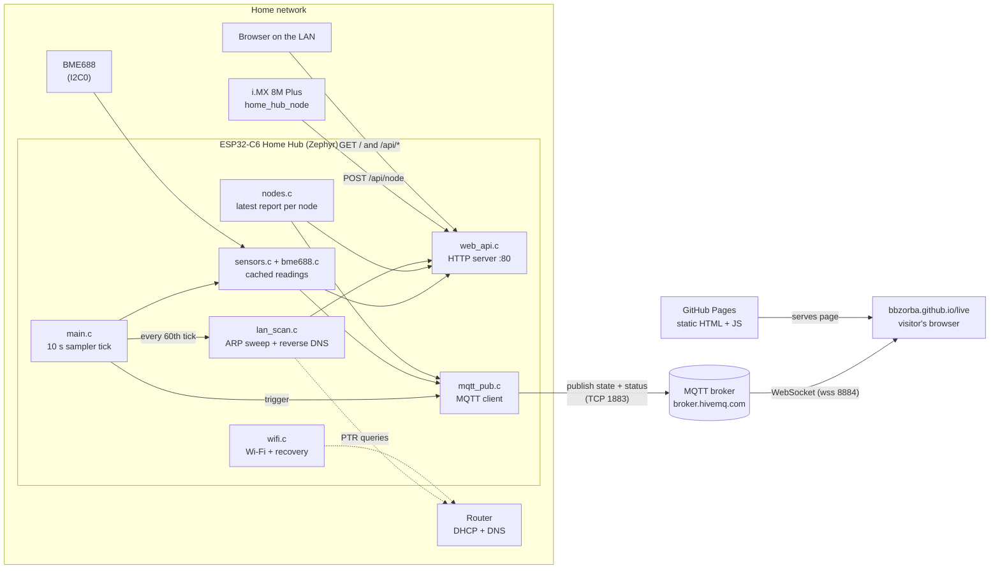
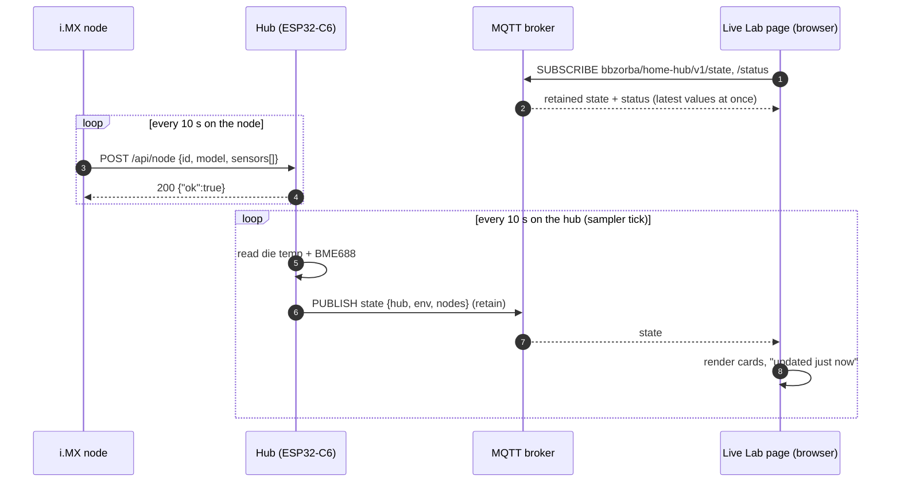
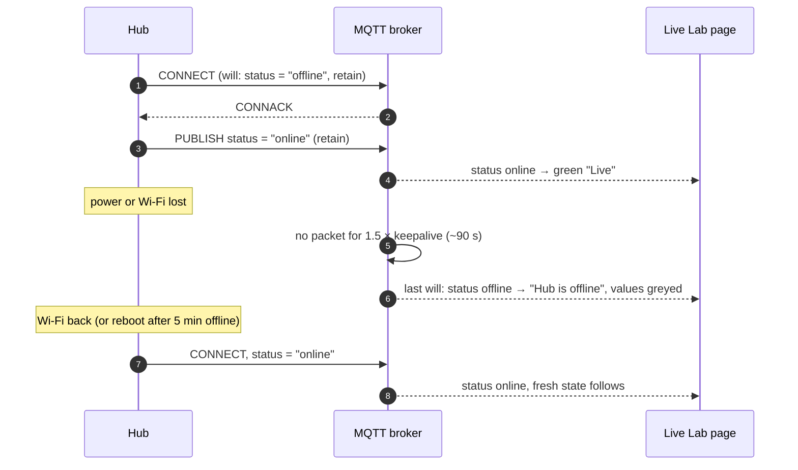
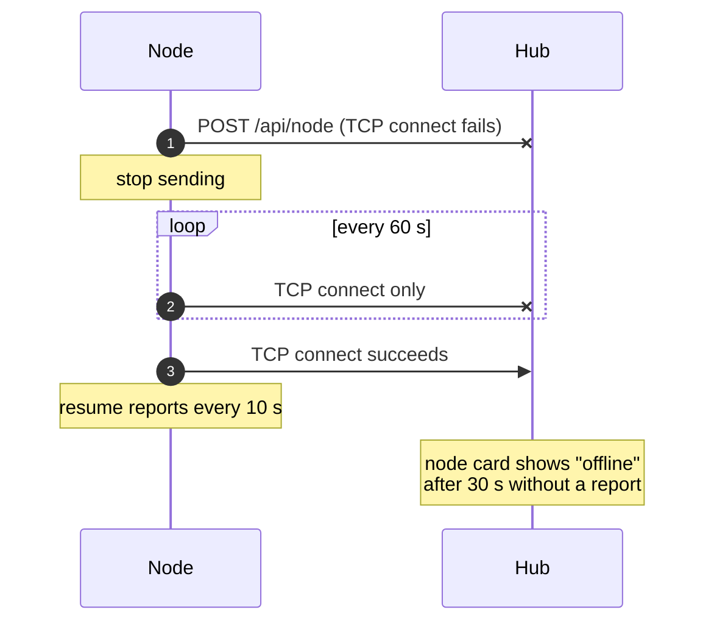
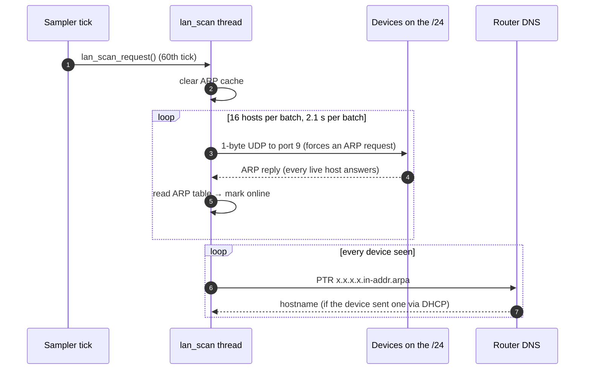

# Home Hub architecture

How the ESP32-C6 Home Hub, its client nodes, the MQTT broker and the Live
Lab page on [bbzorba.github.io](https://bbzorba.github.io/live) fit
together. Build, wiring and API details are in [README.md](README.md).

## The big picture

The system has two hops with two different patterns:

1. **Nodes → hub: request/response (HTTP).** Each client node POSTs its
   readings to the hub every 10 s. The hub keeps the latest report per node.
2. **Hub → browsers: publish/subscribe (MQTT).** Every 10 s the hub publishes
   one message containing its own readings, the BME688 and *all* nodes. The
   broker fans it out to every browser that has the Live Lab page open.

Only the hub talks to the broker, so nodes never need internet access, MQTT
or credentials. Everything a node reports reaches the website automatically.



## Inside the hub

| Thread / context | Wakes up | Does |
|---|---|---|
| `main` (sampler) | every 10 s (one `k_timer`) | reads chip temperature and BME688 together, triggers the MQTT publish, starts a LAN scan every 60th tick |
| `mqtt_tid` | on the sampler's trigger, or when the keepalive is due | connects to the broker, publishes `state`, sends pings |
| `lan_scan_tid` | when the sampler (or "Scan now") asks | ~35 s ARP sweep of the /24, then PTR lookups for names |
| HTTP server (Zephyr) | on incoming requests | dashboard, JSON API, node reports |
| Wi-Fi work item | on connect timeouts | retries every 30 s, reboots after 5 min offline |

The sampler is the only periodic timer, so sensor reads, the MQTT publish
and (every 10 minutes) the scan start all happen in the same wake-up.

## Sequences

### Every 10 seconds: from sensor to website



### Hub connects, drops off, comes back



### A node loses the hub



### LAN scan (every 10 minutes or "Scan now")



## Adding a new node

Nothing changes on the hub or the website:

1. On the new board, every 10 s, POST JSON to `http://home-hub/api/node`:
   ```json
   {"id":"<unique id, e.g. hostname>","model":"<board name>",
    "sensors":[{"name":"Temperature","value":21.5,"unit":"°C"}]}
   ```
   Send raw UTF-8 (Zephyr's JSON parser keeps `\uXXXX` escapes as text).
2. The hub's local dashboard shows it as a new card; the next MQTT `state`
   message contains it, so the Live Lab page shows it too.

Limits: 4 nodes, 16 sensors per node, names up to 23 bytes, units up to 7
bytes (`MAX_NODES`, `MAX_SENSORS` in `src/nodes.c`). A node that stops
reporting is shown as offline after 30 s; if the table is full, the node
silent for longest is replaced.

For a node that should bypass the hub and publish to MQTT itself, the Live
Lab page would need to subscribe to its topic too; the hub-centred design
avoids that.

## Security notes

- The broker is public: anyone who knows the topic can read the values and
  could publish fake ones. Only sensor values are published; the LAN device
  list, IP/MAC addresses and Wi-Fi name stay on the local dashboard. A
  private broker (e.g. HiveMQ Cloud) with a write password for the hub and a
  read-only user for the page closes this.
- The local dashboard and `/api/node` have no authentication; they are only
  reachable from the LAN.
