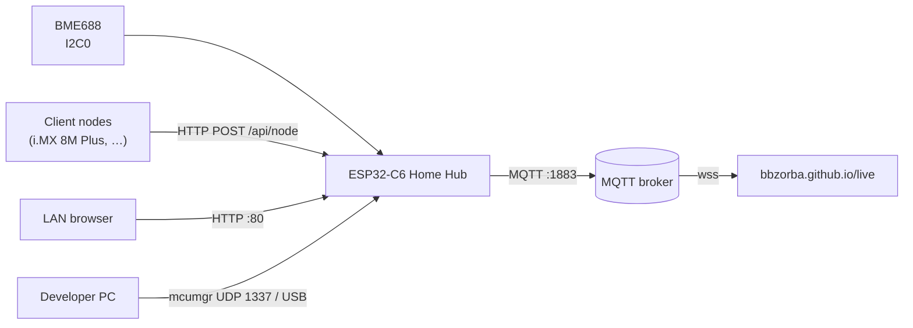
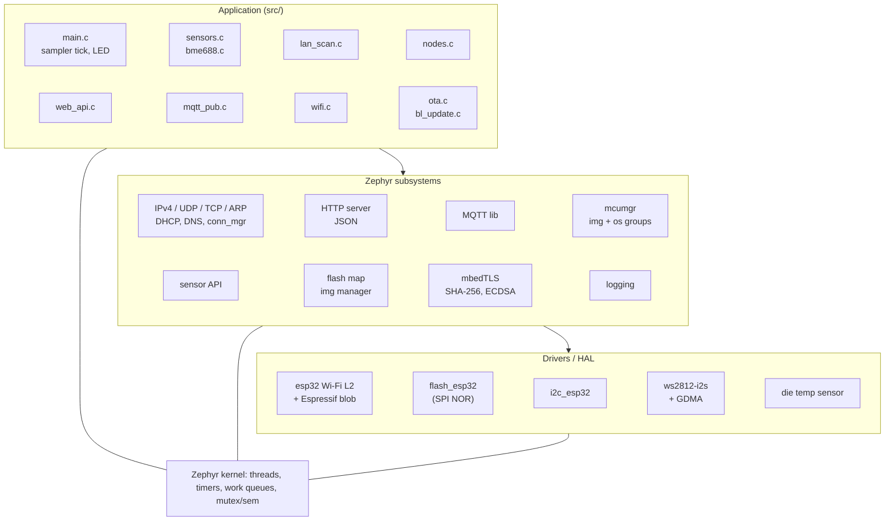
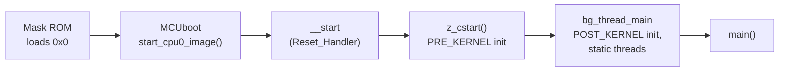
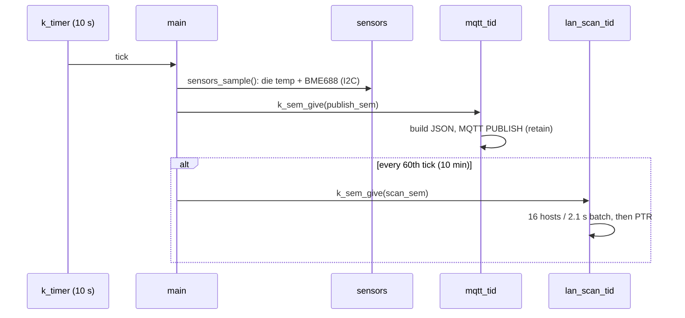

# Home Hub firmware architecture

ESP32-C6 (RISC-V, 160 MHz, 512 KB HP SRAM, 8 MB SPI flash), Zephyr 4.3,
MCUboot. Boot and update design: [BOOTLOADER.md](BOOTLOADER.md). Build,
test and interfaces: [README.md](README.md).

## 1. System context

The hub is the only node that talks to the internet: nodes report to it
over the LAN, and it republishes everything in one MQTT message.

## 2. Software layers

## 3. Memory

**Flash (8 MB, executed in place through the cache/MMU):**

| Offset | Size | Partition | Content |
|---|---|---|---|
| 0x000000 | 64 KB | `boot_partition` | MCUboot (loaded to SRAM by the ROM) |
| 0x010000 | 64 KB | `sys_partition` | unused |
| 0x020000 | 1.75 MB | `slot0_partition` | running application (~720 KB used) |
| 0x1E0000 | 1.75 MB | `slot1_partition` | update staging / previous image |
| 0x3A0000 | 64 KB | `slot*_lpcore` | unused (LP core) |
| 0x3B0000 | 192 KB | `storage_partition` | unused |
| 0x3E0000 | 124 KB | `scratch_partition` | unused in swap-using-move |
| 0x3FF000 | 4 KB | `coredump_partition` | unused |
| 0x400000 | 4 MB | – | unused (the 4 MB partition table is used) |

**RAM (HP SRAM):** 291 KB of 425 KB used statically (68 %): 55 KB of IRAM code
(interrupt handlers and everything that must run while the flash cache is
off, e.g. the flash driver), data, thread stacks, heaps and network buffers.

Heaps: system heap 32 KB (+ Wi-Fi driver's own), mbedTLS heap 8 KB (only
used during a bootloader signature check).

**Image layout and linking.** There is no hand-written linker script: the
SoC template `zephyr/soc/espressif/esp32c6/default.ld` is run through the C
preprocessor with `.config` and the devicetree into
`build/web_app/zephyr/linker.cmd`. The link runs twice: the first pass
(`zephyr_pre0.elf`) generates the interrupt table (`isr_tables.c`), the
second gives `zephyr.elf`; imgtool then signs `zephyr.bin`. Each section
has a run address (VMA) and an offset in the image (LMA), relative to slot 0
(values from `zephyr.map`, v1.2.3):

| Section | Runs at (VMA) | In image (LMA) | Size | Put there by |
|---|---|---|---|---|
| MCUboot header | – | 0x00 | 32 B | imgtool |
| `.metadata` (load header) | – | 0x20 | 80 B | linker: magic `0xace637d3`, entry point, VMA/LMA/size of each segment below |
| `.iram0.text` | 0x40800000 | 0x80 | 55 KB | MCUboot copies to SRAM |
| `.dram0.data` | 0x4080D940 | 0xD9A4 | 18 KB | MCUboot copies to SRAM |
| `.flash.text` | 0x42000000 | 0x20000 | 497 KB | MMU maps it (XIP through the cache) |
| `.flash.rodata` | 0x42800000 | 0xA0000 | 77 KB | MMU maps it |

`default.ld` (`.iram0.text`, lines 289–353) lists what must be in IRAM:
vectors, kernel, arch code, flash driver, system timer, log core. They run
while a flash erase/write has the cache switched off; everything else runs
from flash.

## 4. Startup and interrupts

| Step | Code (Zephyr 4.3; paths under `external/`, fetched by west) | Does |
|---|---|---|
| 1 | mask ROM | checks GPIO9, loads the ESP image at flash 0x0 (MCUboot) into SRAM |
| 2 | `mcuboot/boot/espressif/port/esp_loader.c:154` `start_cpu0_image()` | checks the load header magic (line 75), **copies IRAM and DRAM (incl. `.data`) to SRAM**, calls the entry point |
| 3 | `zephyr/soc/espressif/common/loader.c:267` `__start` | `mtvec = _vector_table` (271), interrupts off, `gp`, zero `.bss`, `map_rom_segments()` (319): MMU maps slot 0 to 0x42000000 / 0x42800000 |
| 4 | `zephyr/kernel/init.c:538` `z_cstart()` | init levels EARLY, PRE_KERNEL_1/2: interrupt controller, system timer, flash, UART |
| 5 | `zephyr/kernel/init.c:283` `bg_thread_main` | POST_KERNEL (302): network, Wi-Fi, logging, mcumgr; APPLICATION (318); starts every `K_THREAD_DEFINE` thread (320); calls `main()` (347) → [src/main.c](src/main.c) |

The entry point is `ENTRY(CONFIG_KERNEL_ENTRY)` = `__start` (`default.ld:106`);
`loader.c:89` places its address in `.entry_addr`, which the linker writes
into the load header.

**Interrupts (RISC-V, no NVIC):**

- `zephyr/soc/espressif/esp32c6/vectors.S`: the vector table at 0x40800000
  (IRAM, 256-byte aligned) is 32 identical *instructions* `j _isr_wrapper`;
  the CPU jumps to `mtvec + 4 × cause` (interrupts) or to entry 0
  (exceptions).
- `zephyr/arch/riscv/core/isr.S:648`: `_isr_wrapper` saves the context,
  reads `mcause` and calls the handler from `_sw_isr_table` (generated
  `isr_tables.c`).
- `zephyr/drivers/interrupt_controller/intc_esp32.c:662`: peripheral
  sources reach the 32 CPU lines through the interrupt matrix; each driver's
  `esp_intr_alloc()` picks a free line (301) and routes its source (613) at
  run time.

## 5. Threads and execution contexts

Zephyr priorities: negative = cooperative (runs until it blocks), 0…14 =
preemptive, lower number wins; equal-priority preemptive threads share
the CPU in 20 ms slices. With `NUM_COOP_PRIORITIES=16`,
`K_PRIO_COOP(15)` = −1 and `K_LOWEST_APPLICATION_THREAD_PRIO` = 14
(`zephyr/include/zephyr/kernel.h:54–61`). Only our two threads set their
priority in our code; the rest are Zephyr defaults (effective values in
`build/web_app/zephyr/.config`; `zephyr/…` paths are under `external/`).

| Context | Prio | Stack | Priority set in | Wakes on | Work |
|---|---|---|---|---|---|
| ISRs | – | 2 KB (ISR stack) | – | Wi-Fi, timer, GDMA, UART | hand off to threads |
| system work queue | −1 coop | 4 KB | `CONFIG_SYSTEM_WORKQUEUE_PRIORITY` | `k_work` submits | Wi-Fi reconnect + stuck/offline reboot (`wifi.c`), image confirm + bootloader update (`ota.c`) |
| net RX | −1 coop | 2 KB | `zephyr/subsys/net/ip/net_tc.c:167` | received packets | IP/UDP/TCP/ARP input |
| net mgmt events | −1 coop | 2 KB | `zephyr/subsys/net/ip/net_mgmt.c:416` | stack events | L4 up/down → `wifi.c` callback |
| conn_mgr monitor | −1 coop | 512 B | `zephyr/subsys/net/conn_mgr/conn_mgr_monitor.c:20` | interface events | online/offline (L4) |
| HTTP server | −1 coop | 4 KB | `zephyr/subsys/net/lib/http/http_server_core.c:32` | TCP :80 | dashboard + JSON API |
| ESP timer task | 3 | 4 KB | `CONFIG_ESP32_TIMER_TASK_PRIO` | `esp_timer` | Wi-Fi driver timers |
| Espressif Wi-Fi tasks | ≤ 7 | blob | `CONFIG_ESP32_WIFI_MAX_THREAD_PRIORITY` | radio | 802.11, WPA |
| `main` (sampler) | 0 | 4 KB | `CONFIG_MAIN_THREAD_PRIORITY` | `k_timer` every 10 s | read sensors, trigger MQTT, start a scan every 60th tick, LED |
| mcumgr UDP | 0 | 4 KB | `CONFIG_MCUMGR_TRANSPORT_UDP_THREAD_PRIO` | UDP 1337 | image upload to slot 1, state, reset |
| `mqtt_tid` | 14 | 3 KB | [src/mqtt_pub.c:282](src/mqtt_pub.c#L282) | `publish_sem`, keepalive | connect, publish, ping |
| `lan_scan_tid` | 14 | 2 KB | [src/lan_scan.c:276](src/lan_scan.c#L276) | `scan_sem` | ARP sweep (~35 s), PTR lookups |
| socket service | 14 | 1.2 KB | `zephyr/subsys/net/lib/sockets/sockets_service.c:294` (default 15, clamped) | DNS replies | DNS resolver sockets |
| logging | 14 | 768 B | `zephyr/subsys/logging/log_core.c:62` | log messages | UART output |
| idle | 15 | 512 B | kernel | – | CPU idle (`wfi`) |

The application's long-running jobs (MQTT, LAN scan) run at the lowest
priority, so the network stack and the HTTP server always preempt them.
The one exception is priority inheritance: while a priority-14 thread holds
a mutex that the HTTP thread waits for, the kernel raises it to −1 until it
unlocks (microseconds, the locks guard only copies).

**Shared data:** each module keeps its state behind one
`static K_MUTEX_DEFINE(lock)`; readers take a copy under the lock.

| Module | Lock | Writer (thread) | Readers (thread) |
|---|---|---|---|
| sensors | [sensors.c:17](src/sensors.c#L17) | `sensors_sample()` (`main`) | `sensors_get()` (HTTP, MQTT) |
| nodes | [nodes.c:79](src/nodes.c#L79) | `nodes_report()` (HTTP POST) | `nodes_encode()` (HTTP, MQTT) |
| lan_scan | [lan_scan.c:52](src/lan_scan.c#L52) | scan thread (ARP callback, names, start/end) | `lan_scan_request()` (`main`), `lan_scan_snapshot()` (HTTP) |

Triggers between threads are binary `k_sem`s (maximum count 1), so a
trigger while a job runs is merged, not queued: `scan_sem`
([lan_scan.c:53](src/lan_scan.c#L53)) and `publish_sem`
([mqtt_pub.c:75](src/mqtt_pub.c#L75)).

## 6. Timing

One periodic timer for everything keeps the CPU asleep between ticks;
client node reports and HTTP requests are event-driven.

## 7. Fault handling

| Fault | Detection | Reaction |
|---|---|---|
| Wi-Fi lost | conn_mgr L4 down | reconnect every 30 s |
| Wi-Fi driver stuck "connecting" (after power-on) | connecting, no disconnect event for 60 s | `sys_reboot()`; a software reset always clears it |
| Still offline | 5 min without a connection | `sys_reboot()` |
| Bad new firmware | not confirmed before the next reset | MCUboot swaps back (BOOTLOADER.md §2) |
| Hub off / unplugged | MQTT keepalive missed | broker publishes last will `offline` |
| Client node silent | no report for 30 s | shown offline |
| Corrupt or foreign bootloader image | SHA-256 / ECDSA check | rejected, 0x0 untouched |

## 8. Crucial points

- **One wake-up source.** All periodic work hangs off one 10 s `k_timer`;
  everything else is event-driven, so adding a feature never adds a timer.
- **Slow work at the lowest priority.** MQTT and the LAN scan (seconds
  long) run at priority 14; the network stack and HTTP server are
  cooperative and always get the CPU first.
- **Flash writes only from the system work queue**, never from network
  callbacks: confirming an image and installing a bootloader both run
  there.
- **The hub must stay reachable to stay updatable.** The Wi-Fi watchdog,
  late confirmation and the bootloader rule (only a confirmed, online
  firmware touches 0x0) all serve that.
