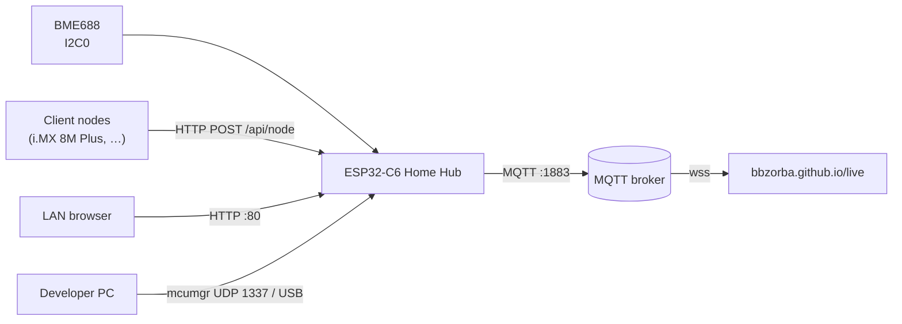
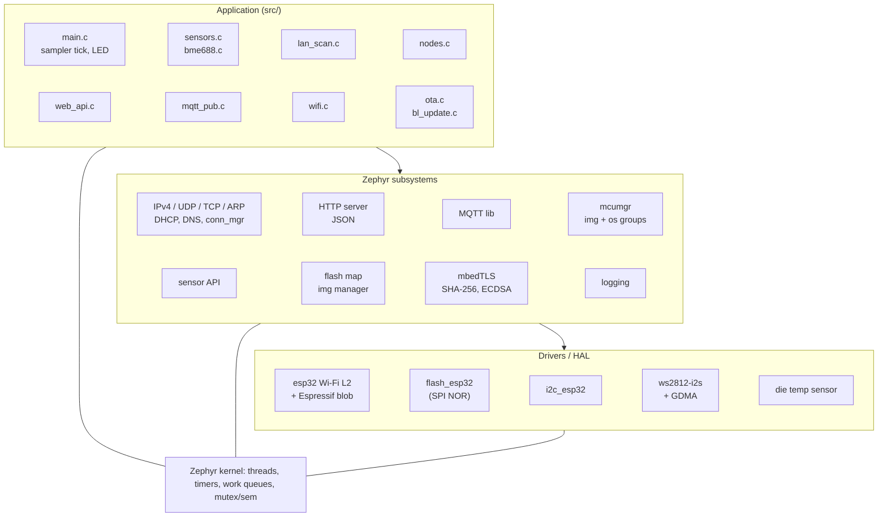
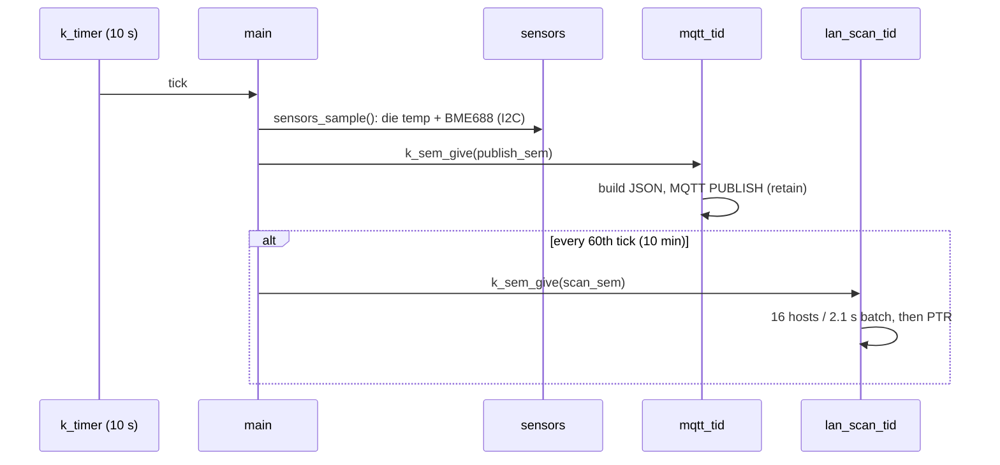

# Home Hub firmware architecture

ESP32-C6 (RISC-V, 160 MHz, 512 KB HP SRAM, 8 MB SPI flash), Zephyr 4.3,
MCUboot. Boot and update design: [BOOTLOADER.md](BOOTLOADER.md). Build,
test and interfaces: [README.md](README.md).

## 1. System context

The hub is the only node that talks to the internet: nodes report to it
over the LAN, and it republishes everything in one MQTT message.

## 2. Software layers

## 3. Memory

**Flash (8 MB, executed in place through the cache/MMU):**

| Offset | Size | Partition | Content |
|---|---|---|---|
| 0x000000 | 64 KB | `boot_partition` | MCUboot (loaded to SRAM by the ROM) |
| 0x010000 | 64 KB | `sys_partition` | unused |
| 0x020000 | 1.75 MB | `slot0_partition` | running application (~720 KB used) |
| 0x1E0000 | 1.75 MB | `slot1_partition` | update staging / previous image |
| 0x3A0000 | 64 KB | `slot*_lpcore` | unused (LP core) |
| 0x3B0000 | 192 KB | `storage_partition` | unused |
| 0x3E0000 | 124 KB | `scratch_partition` | unused in swap-using-move |
| 0x3FF000 | 4 KB | `coredump_partition` | unused |
| 0x400000 | 4 MB | – | unused (the 4 MB partition table is used) |

**RAM (HP SRAM):** 291 KB of 425 KB used statically (68 %): 55 KB of IRAM code
(interrupt handlers and everything that must run while the flash cache is
off, e.g. the flash driver), data, thread stacks, heaps and network buffers.

Heaps: system heap 32 KB (+ Wi-Fi driver's own), mbedTLS heap 8 KB (only
used during a bootloader signature check).

## 4. Threads and execution contexts

Zephyr priorities: negative = cooperative (runs until it blocks), 0…14 =
preemptive, lower number wins; equal-priority preemptive threads share
the CPU in 20 ms slices.

| Context | Prio | Stack | Wakes on | Work |
|---|---|---|---|---|
| ISRs | – | 2 KB (ISR stack) | Wi-Fi, timer, GDMA, UART | hand off to threads |
| system work queue | −1 coop | 4 KB | `k_work` submits | Wi-Fi reconnect + stuck/offline reboot (`wifi.c`), image confirm + bootloader update (`ota.c`) |
| net RX (traffic class) | coop | 2 KB | received packets | IP/UDP/TCP/ARP input |
| net mgmt events | −1 coop | 2 KB | stack events | L4 up/down → `wifi.c` callback |
| HTTP server | −1 coop | 4 KB | TCP :80 | dashboard + JSON API |
| Espressif Wi-Fi tasks | ≤ 7 | blob | radio | 802.11, WPA |
| `main` (sampler) | 0 | 4 KB | `k_timer` every 10 s | read sensors, trigger MQTT, start a scan every 60th tick, LED |
| mcumgr UDP | 0 | 4 KB | UDP 1337 | image upload to slot 1, state, reset |
| `mqtt_tid` | 14 | 3 KB | `publish_sem`, keepalive | connect, publish, ping |
| socket service | 14 | 1.2 KB | DNS replies | DNS resolver sockets |
| `lan_scan_tid` | 14 | 2 KB | `scan_sem` | ARP sweep (~35 s), PTR lookups |
| logging | low | 768 B | log messages | UART output |
| idle | lowest | 512 B | – | CPU idle (`wfi`) |

The application's long-running jobs (MQTT, LAN scan) run at the lowest
priority, so the network stack and the HTTP server always preempt them.

**Shared data:** `sensors.c`, `nodes.c` and `lan_scan.c` each keep their
state behind a `k_mutex`; readers (HTTP, MQTT) take a copy under the lock.
Triggers between threads are binary `k_sem`s (`scan_sem`, `publish_sem`),
so a trigger while a job runs is merged, not queued.

## 5. Timing

One periodic timer for everything keeps the CPU asleep between ticks;
client node reports and HTTP requests are event-driven.

## 6. Fault handling

| Fault | Detection | Reaction |
|---|---|---|
| Wi-Fi lost | conn_mgr L4 down | reconnect every 30 s |
| Wi-Fi driver stuck "connecting" (after power-on) | connecting, no disconnect event for 60 s | `sys_reboot()`; a software reset always clears it |
| Still offline | 5 min without a connection | `sys_reboot()` |
| Bad new firmware | not confirmed before the next reset | MCUboot swaps back (BOOTLOADER.md §2) |
| Hub off / unplugged | MQTT keepalive missed | broker publishes last will `offline` |
| Client node silent | no report for 30 s | shown offline |
| Corrupt or foreign bootloader image | SHA-256 / ECDSA check | rejected, 0x0 untouched |

## 7. Crucial points

- **One wake-up source.** All periodic work hangs off one 10 s `k_timer`;
  everything else is event-driven, so adding a feature never adds a timer.
- **Slow work at the lowest priority.** MQTT and the LAN scan (seconds
  long) run at priority 14; the network stack and HTTP server are
  cooperative and always get the CPU first.
- **Flash writes only from the system work queue**, never from network
  callbacks: confirming an image and installing a bootloader both run
  there.
- **The hub must stay reachable to stay updatable.** The Wi-Fi watchdog,
  late confirmation and the bootloader rule (only a confirmed, online
  firmware touches 0x0) all serve that.
