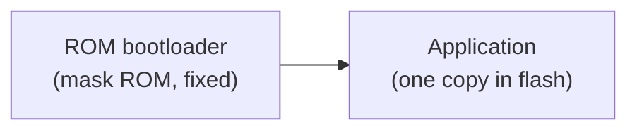
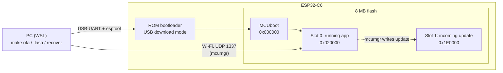
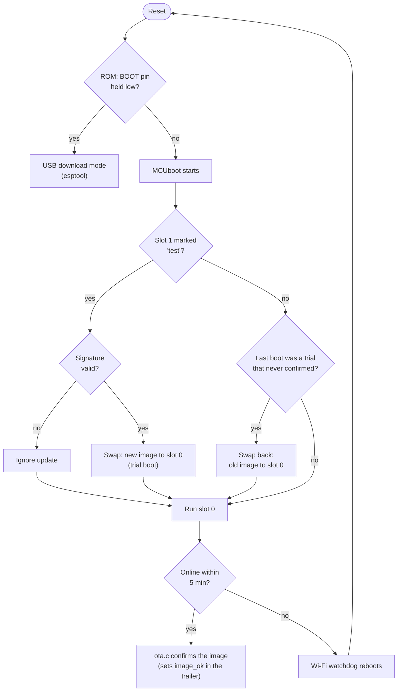

# Bootloader design

How the Home Hub (ESP32-C6, Zephyr) boots and updates itself, and why it's
built this way. For the overall system see [ARCHITECTURE.md](ARCHITECTURE.md).

## 1. How an ESP32-C6 normally boots



Out of the box, a Zephyr app on the ESP32-C6 is loaded directly by the
ROM bootloader. There is exactly one copy of the firmware: updating it
means overwriting it over USB, and a bad image stays bad.

## 2. What we built



| Component | Where | Job |
|---|---|---|
| ROM bootloader | inside the chip, unchangeable | Starts MCUboot; offers USB download mode for esptool |
| **MCUboot** | flash 0x000000 | Checks the update's signature, swaps images, rolls back |
| Slot 0 | flash 0x020000 (1.75 MB) | The firmware that runs |
| Slot 1 | flash 0x1E0000 (1.75 MB) | Where a new image is uploaded; afterwards holds the previous one |
| mcumgr (in the app) | Zephyr subsystem | Receives images over Wi-Fi, marks them for test, resets |
| `ota.c` (in the app) | our code | Confirms the running image once the hub is online |
| Signing key | `keys/`, not in git | Signs every image; MCUboot only accepts our signature |

## 3. Where the old and new firmware live during an update

MCUboot uses **swap using move**: both images are always kept, so it can
switch back.

| Moment | Slot 0 (runs) | Slot 1 |
|---|---|---|
| Before | old v1.1.0 | empty / outdated |
| After upload | old v1.1.0 | **new v1.1.1** (marked "test") |
| After the swap at reset | **new v1.1.1** (trial) | old v1.1.0 |
| New firmware gets online | new v1.1.1 (**confirmed**) | old v1.1.0 (kept as backup) |
| …or it never confirms | old v1.1.0 (swapped back) | new v1.1.1 |

The swap copies sector by sector and records its progress at the end of
the slots (the "trailer"), so a power cut in the middle is resumed at the
next boot rather than leaving a half-written image.

## 4. Rollback: what happens at every reset



The rule is simple: **a new image must prove itself by reaching the network;
if it resets before that, MCUboot restores the previous one.** "Confirmed"
is one flag (`image_ok`) in the slot trailer, written by
`boot_write_img_confirmed()` in `src/ota.c` when Wi-Fi and IP are up.

## 5. Who resets the chip, and how

| Reset | Triggered by | Result |
|---|---|---|
| After an OTA upload | `make ota` sends mcumgr `os reset` → `sys_reboot()` | MCUboot swaps in the new image |
| Wi-Fi watchdog | `src/wifi.c`: offline for 5 min → `sys_reboot()` | Reboot; also reverts an unconfirmed trial |
| USB flashing | esptool toggles the USB-UART's **DTR/RTS** lines, which the DevKit wires to **EN** (reset) and **GPIO9** (BOOT) | GPIO9 low during reset → ROM download mode |
| Manual | RESET button (hold BOOT too for download mode) | Normal boot / download mode |

## 6. Crucial points

- **Signed updates only.** OTA images are checked against our ECDSA P-256
  key before anything is swapped. Lose the key and OTA stops working until a
  USB reinstall with a new key: back it up.
- **USB is always the safety net.** The ROM bootloader can't be erased, so
  even a broken MCUboot is recoverable with `make flash`.
- **Two Zephyr 4.3 quirks we worked around** (`sysbuild/mcuboot.conf`):
  Espressif's MCUboot settings for the C6 were silently skipped (file name
  mismatch), which broke the link, so we apply them ourselves; and MCUboot's
  own USB "serial recovery" doesn't build for Espressif, so USB recovery
  uses the ROM bootloader instead.
- **Confirm late, not early.** Confirming only after the network is up
  guarantees that a kept image can always receive the next update.

## 7. How to test it

From WSL in the repo root, with the board's USB attached to WSL
(`usbipd attach --wsl --busid 2-10`, after `wsl -u root -- modprobe vhci_hcd`):

```bash
# 1. Full install over USB (first time, or after MCUboot changes)
make build
make flash PORT=/dev/ttyUSB0

# 2. OTA: bump PATCHLEVEL in applications/web_app/VERSION, then
make build
make ota                      # HUB_IP=192.168.178.172 by default
#    → waits (up to 6 min) until the hub answers, uploads, resets, and
#      returns once the hub runs the new image and has confirmed it

# 3. USB rewrite of the app only (e.g. if it can't reach Wi-Fi)
make recover PORT=/dev/ttyUSB0
```

To see a rollback, upload an image and reset the hub before it gets
online (e.g. switch off the router, or press RESET within a few seconds of
the update): the serial log shows `Swap type: revert` and the previous
version comes back.

`make ota` only works while the hub is on Wi-Fi. Right after a reset or a
USB flash it can take up to 5 minutes to rejoin (the Wi-Fi driver sometimes
hangs and the watchdog reboots it); `make ota` waits for that, and says so
if the hub never answers.

Tested on the board (Nov 2026): USB install, OTA 1.1.0 → 1.1.1 in 22 s,
rollback after an unconfirmed trial boot, and USB app rewrite.
