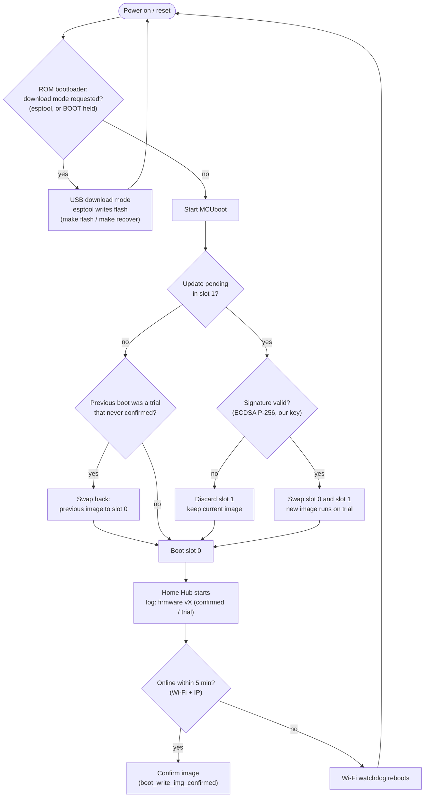
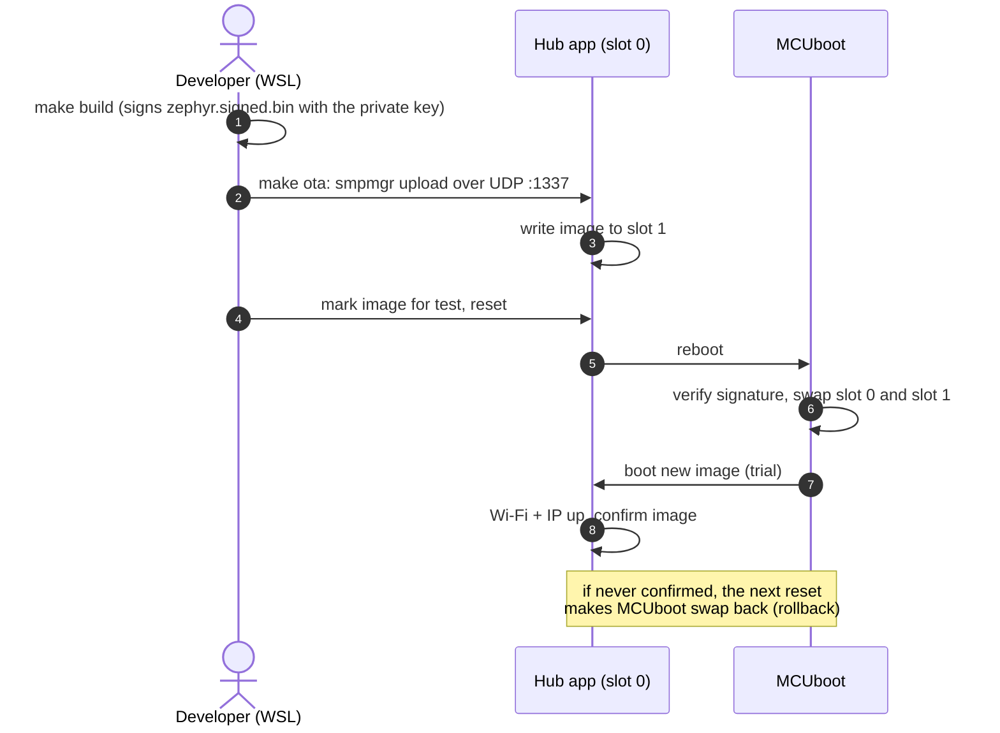

# Bootloader and firmware updates

The Home Hub runs standalone on a USB power plug. It uses Zephyr's standard
boot setup for the ESP32-C6: the chip's ROM bootloader starts **MCUboot**
(built by sysbuild from Zephyr's MCUboot module), and MCUboot starts the
application. Updates come in three ways:

| Way | Needs | Command | Use it for |
|---|---|---|---|
| **Over the air (OTA)** | Wi-Fi, hub running | `make ota` | Normal updates |
| **USB, application only** | USB cable | `make recover PORT=/dev/ttyUSB0` | App broken or unreachable over Wi-Fi |
| **USB, full install** | USB cable | `make flash PORT=/dev/ttyUSB0` | First install, MCUboot changes |

Both USB paths go through the ESP32-C6's **ROM bootloader**, which lives in
mask ROM and can't be erased or overwritten. The board can therefore always
be recovered over USB, even if MCUboot itself were damaged. esptool resets
the chip into the ROM's download mode on its own; if that ever fails, hold
**BOOT** while pressing **RESET**.

MCUboot's own serial recovery mode isn't used: in Zephyr 4.3 it doesn't
link for Espressif SoCs (see `sysbuild/mcuboot.conf`), and the ROM path is
more robust anyway.

## Boot chain and flash layout

```
ESP32-C6 ROM bootloader (mask ROM)    USB download mode for esptool
   └─> MCUboot          @ 0x000000   checks signatures, swaps, rolls back
         └─> Home Hub   @ 0x020000   slot 0: the running image
             (update)   @ 0x1E0000   slot 1: where an OTA upload lands
```

8 MB flash, partitions from Zephyr's `partitions_0x0_default.dtsi`:

| Partition | Offset | Size | Use |
|---|---|---|---|
| `mcuboot` | 0x000000 | 64 KB | MCUboot |
| `sys` | 0x010000 | 64 KB | system data |
| `image-0` (slot 0) | 0x020000 | 1792 KB | running application |
| `image-1` (slot 1) | 0x1E0000 | 1792 KB | uploaded update |
| `image-scratch` | 0x3E0000 | 124 KB | unused in swap-using-move |

## What happens at every reset



## Over-the-air update

The application runs Zephyr's mcumgr (SMP) server on UDP port 1337 with the
image and OS management groups. `make ota` uses
[smpmgr](https://github.com/intercreate/smpmgr) in three steps: `image
upload`, `image state-write <hash>` (marks the image for a trial boot; the
hash comes from `tools/image_hash.sh`) and `os reset`. smpmgr's one-step
`upgrade` command (0.17, the last version for Python 3.10) didn't set the
trial mark, so the steps are explicit.



Bump `VERSION` before an update. The dashboard (Hub card, "Firmware") and
`/api/status` (`fw`, `fw_confirmed`) show which image runs and whether it's
still on trial.

## Commands (WSL)

```bash
make build                           # sysbuild: MCUboot + signed app
make flash PORT=/dev/ttyUSB0         # full install over USB
make ota                             # update over Wi-Fi (HUB_IP=192.168.178.172)
make recover PORT=/dev/ttyUSB0       # rewrite only the app over USB
```

To use the board's USB port from WSL (admin PowerShell; `bind` only once):

```powershell
usbipd bind --busid 2-10
wsl -u root -- modprobe vhci_hcd   # the first attach after WSL starts fails without it
usbipd attach --wsl --busid 2-10
```

While attached, Windows doesn't see the port (COM8); `usbipd detach
--busid 2-10` gives it back.

## Tested on the board (Nov 2026)

| Test | Result |
|---|---|
| Full USB install (`make flash`) | ROM → MCUboot → app 1.1.0, swap type none |
| OTA 1.1.0 → 1.1.1 (`make ota`) | 22 s; MCUboot swapped, 1.1.1 confirmed itself 7 s after boot |
| Rollback | 1.1.0 uploaded and marked for test, reset during its trial boot: MCUboot logged `Swap type: revert` and 1.1.1 came back confirmed |
| USB app-only rewrite (`make recover`) | esptool wrote slot 0 in 37 s, MCUboot booted it normally |

Known issue: right after a hardware reset (USB flash, RESET button) the
ESP32 Wi-Fi driver sometimes gets stuck connecting; the hub then reboots
itself after 5 minutes and connects normally (see `src/wifi.c`). OTA resets
are software resets, where this hasn't been seen. If it ever hit a trial
boot, the watchdog reboot would make MCUboot revert to the previous image:
safe, just run `make ota` again.

## Signing key

MCUboot only installs OTA images signed with the key it was built with
(`sysbuild.conf`). The private key is **not in git**:

```bash
.venv-wsl/bin/imgtool keygen -k applications/web_app/keys/hub-signing-key.pem -t ecdsa-p256
```

Back it up somewhere safe. If it's lost, OTA updates are impossible until
the board gets a full USB install with a new key.

## Security notes

- The OTA port (UDP 1337) has no password: anyone on the LAN can upload an
  image or reset the hub. They can't install their own firmware, though:
  MCUboot rejects every update that isn't signed with the private key.
- USB writes through the ROM bootloader need physical access and aren't
  signature-checked; anyone holding the board can reflash it.
