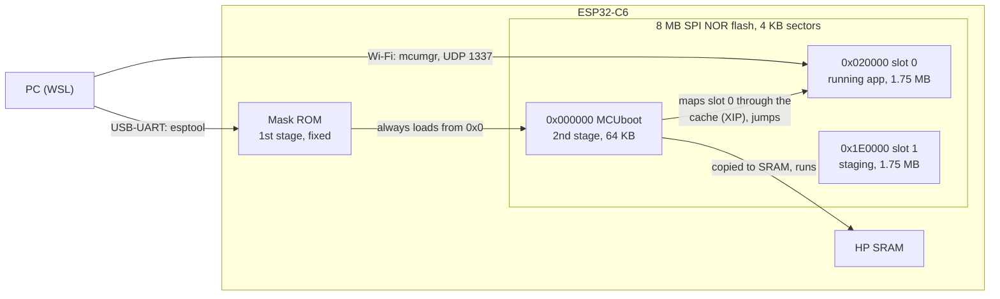
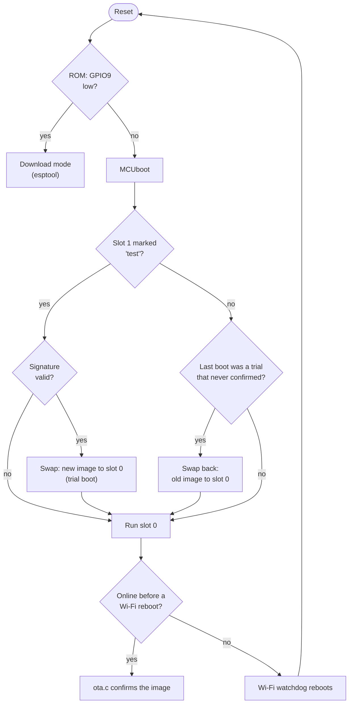
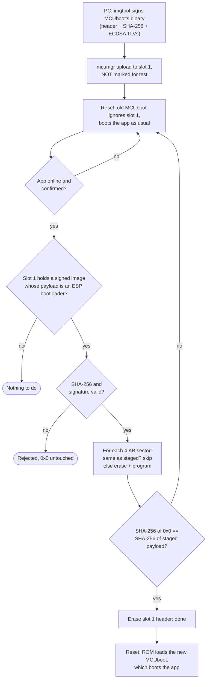

# Bootloader design

How the Home Hub (ESP32-C6, Zephyr) boots and updates its application and
its bootloader. Firmware structure: [ARCHITECTURE.md](ARCHITECTURE.md).
Commands to build, update and test: [README.md](README.md).

## 1. Boot chain and flash

| Stage | Where | Job |
|---|---|---|
| ROM bootloader | mask ROM | Loads the image at flash **0x0** into SRAM; with GPIO9 low at reset: USB/UART download mode (esptool) |
| MCUboot | flash 0x0, 64 KB | Checks signatures, swaps slot 0/1, rolls back, starts slot 0 |
| Application | slot 0 | The hub; receives updates into slot 1 (mcumgr) and confirms itself |

The flash is one external SPI NOR array. There are no banks: code runs
from it through the cache, and during each erase or program operation
Zephyr's flash driver suspends the cache and runs from internal RAM. The
application keeps running between operations.

## 2. Application update (`make ota`)

MCUboot runs in **swap using move** mode, so the old and the new image are
both kept.

| Moment | Slot 0 (runs) | Slot 1 |
|---|---|---|
| Before | old v1 | empty / outdated |
| After upload | old v1 | **new v2**, marked "test" |
| Reset: MCUboot verifies the signature, swaps | **new v2** (trial) | old v1 |
| v2 gets online → `ota.c` confirms (`image_ok`) | v2, confirmed | old v1, kept |
| …or v2 resets before that | old v1 (swapped back) | v2 |

**A new image must prove itself by reaching the network; if it resets
before that, MCUboot restores the previous one.** The swap records its
progress in the slot trailers, so a power cut mid-swap resumes at the next
boot.

| Reset | Triggered by | Result |
|---|---|---|
| After an upload | mcumgr `os reset` → `sys_reboot()` | MCUboot swaps the new image in |
| Wi-Fi recovery | `wifi.c`: driver stuck 60 s, or 5 min offline → `sys_reboot()` | Reboot; reverts an unconfirmed trial |
| USB flashing | esptool drives DTR/RTS → EN and GPIO9 | ROM download mode |

## 3. Bootloader update (`make ota-bootloader`)

The same idea as the STM32H7/PX4 bootloader updater: stage the new
bootloader high in the application area, verify it, copy it to the boot
sector, verify the copy, and let the flash contents tell whether it is
finished. What the ESP32-C6 changes:

| | STM32H7 (PX4) | ESP32-C6 (this hub) |
|---|---|---|
| Flash | internal, 2 banks, 128 KB sectors | external SPI NOR, 1 array, 4 KB sectors |
| Where the CPU starts | BOOT_ADD0/1 option bytes | ROM, always from flash **0x0** |
| Point boot away during the update | yes, BOOT_ADD0 → updater (atomic OPTSTRT) | **not possible**: no such register; the ROM's recovery-bootloader eFuse exists only on C5/C61/P4 |
| Updater | separate bootloader_updater app | `bl_update.c` inside the running, confirmed app |
| Code while writing | runs from the other bank | runs from internal RAM during each flash operation (driver) |
| Staging | bank 2, sectors 8–14 | slot 1 (0x1E0000) |
| Check before/after | CRC of image / CRC of sector 0 | SHA-256 + ECDSA P-256 signature / SHA-256 read-back of 0x0 |
| Resume state | option bytes | flash: staged image in slot 1 vs. the sectors at 0x0 |
| If it goes wrong anyway | system ROM bootloader (BOOT0 pin, DFU) | ROM download mode over USB (GPIO9) |

**Power cut or reset during the update:**

| When | What happens |
|---|---|
| Before the first sector is written | Nothing changed; the staged image stays and is installed at the next check |
| While sectors are written (≤ 0.5 s) | 0x0 holds a half-written image; the ROM rejects it and the hub stays off until `make flash` over USB |
| After the read-back matched | Done; slot 1 may still hold the image, the next check finds 0x0 identical and only erases slot 1 |

The middle row is the price of the C6 having no BOOT_ADD: nothing can
redirect the ROM while 0x0 is incomplete. The window is kept short by
writing only the sectors that differ: measured 25–45 ms per 4 KB sector,
so ≤ 0.5 s for all 12 sectors of a ~47 KB MCUboot.

**Order of updates:** install the bootloader first, application later.
Uploading an application overwrites slot 1, i.e. the staged bootloader,
just as uploading PX4 wipes the STM32 updater.

## 4. Crucial points

- **Everything is signed with one ECDSA P-256 key.** MCUboot checks
  applications; `bl_update.c` checks bootloaders against the public half,
  compiled in from the same key. Lose the key and only USB updates remain:
  back it up.
- **USB is always the safety net.** The ROM can't be erased, so even a
  broken MCUboot is recoverable with `make flash`.
- **Confirm late, not early.** Only a confirmed image that is online can
  touch the bootloader, and it confirms only once it can receive the next
  update.
- **Two Zephyr 4.3 quirks** (`sysbuild/mcuboot.conf`): Espressif's MCUboot
  settings for the C6 are skipped because of a file-name mismatch, so we
  apply them ourselves; MCUboot's own serial recovery doesn't build for
  Espressif, so USB recovery uses the ROM instead.
